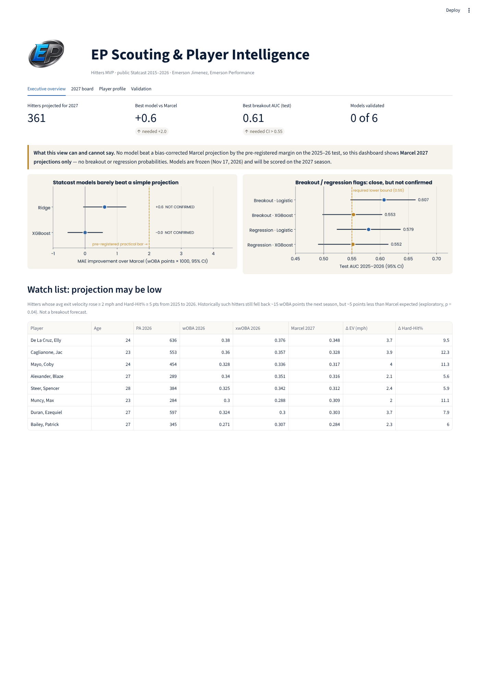
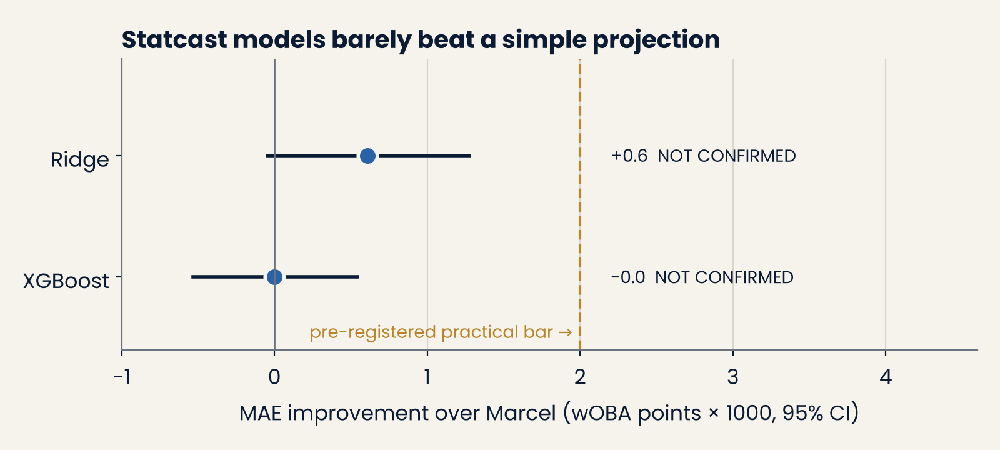

# EP Scouting & Player Intelligence System

**Emerson Performance (EP)** · Emerson Jimenez · public Statcast 2015–2026

**Live app:** [ep-scouting-player-intelligence-system-ekqptyv3xmmxwf4nykfg2e.streamlit.app](https://ep-scouting-player-intelligence-system-ekqptyv3xmmxwf4nykfg2e.streamlit.app/)

> **EN — Headline:** Can public Statcast find MLB hitters who will outperform — or underperform — next season?
> Tested against a simple projection (Marcel) with rules fixed in advance, **no model beat it by the required margin**:
> the best (Ridge) cut next-season wOBA error by 0.6 points (×1000) vs a 2.0 bar; XGBoost added nothing.
> So the dashboard shows Marcel 2027 projections only, and the models are **frozen (Nov 17, 2026) for a forward test on 2027**.
>
> **ES — Titular:** ¿Puede Statcast público encontrar bateadores que rendirán por encima o por debajo el próximo año?
> Contra una proyección simple (Marcel), con reglas fijadas de antemano, **ningún modelo la superó por el margen exigido**.
> El dashboard muestra solo proyecciones Marcel 2027 y los modelos quedan **congelados para evaluarse con la temporada 2027**.



## What the system does today | Qué hace hoy

| Question from the product plan | Status |
|---|---|
| Which hitters have more potential than their stats show? | **Tested — not confirmed.** Breakout classifier AUC 0.61 (CI 0.548–0.662); lower bound missed 0.55. |
| Which hitters are at risk of regression? | **Tested — not confirmed.** AUC 0.58. |
| Early development signals | **Exploratory.** EV +2 mph & Hard-Hit% +5 → ~5 wOBA pts above Marcel next year (p = 0.04), but still a decline vs this year. Shown as "projection may be low". |
| Prospects comparable to MLB successes | Not started — MiLB ingestion works, but MiLB level is not yet mapped. |
| Acquisition opportunities | Out of scope until contract/cost data is added. |

## Key results (test seasons 2025–2026, used once)

| Model | MAE (wOBA) | vs Marcel (95% CI) | Label |
|---|---|---|---|
| Marcel, bias-corrected | 0.0240 | — | BASELINE |
| Ridge | 0.0233 | +0.0006 (−0.00005 to +0.0013) | NOT CONFIRMED |
| XGBoost | 0.0240 | −0.0000 | NOT CONFIRMED |



- **Simple beats complex.** XGBoost never beat the linear models.
- **Survivorship kept:** 26% of eligible hitters lost their role (< 200 PA) the next season. The model did not identify them better than plate appearances alone (AUC 0.69 vs 0.78).
- **Where the small signal is:** average exit velocity, xwOBA − wOBA, Sweet-Spot% (SHAP / Ridge).
- Full write-up: [`docs/PHASE3_RESULTS.md`](docs/PHASE3_RESULTS.md) · design: [`docs/PHASE3_PREREGISTRATION.md`](docs/PHASE3_PREREGISTRATION.md)

## International module: first DSL season | Módulo internacional

Does a player's first Dominican Summer League season tell us more than his age? Yes: out of sample, AUC for reaching Double-A rises from 0.57 to 0.74 (hitters) and 0.73 (pitchers). Code, results and charts: [`international/`](international/).

## Executive dashboard

**Live:** https://ep-scouting-player-intelligence-system-ekqptyv3xmmxwf4nykfg2e.streamlit.app/

```bash
pip install -r requirements.txt
streamlit run app/streamlit_app.py
```
Four views: executive overview, 2027 board (filters by age, PA, signal), player profile (percentiles + signal explanation), validation. The app reads only small files in `results/` — no database needed.

## Forward test 2027
`results/frozen_2026-11-17/` holds the frozen models, their 2027 predictions and SHA-256 hashes. After the 2027 regular season:
```bash
python -m src.ingest_leaderboards --years 2027
python -m src.score_forward     # stops if any frozen file was changed
```

## Architecture

```
Public sources ──► ingestion + JSON manifests ──► DuckDB warehouse ──► features ──► models ──► dashboard
 Phase 1: pitch-level Statcast (MLB + tracked MiLB)      Phase 2–2.1: player-season features, signals
 Phase 2.2: season leaderboards (MVP feature source)     Phase 3: Marcel vs Ridge / XGBoost, frozen for 2027
```
The hitters MVP uses the season leaderboards (Phase 2.2). The pitch-level pipeline (Phase 1–2.1) is verified live and is the source for the next features (pitch-type, swing decisions, MiLB).

## Reproduce

```bash
pip install -r requirements.txt
pip install --pre sportsdataverse            # optional, MiLB adapter (beta)
python -m pytest -q                          # all tests, incl. known-answer test and app smoke test

# Phase 1–2.1: pitch-level warehouse (example week)
python -m src.ingest_statcast --start-date 2025-04-01 --end-date 2025-04-07 --competitions MLB,MiLB
python -m src.build_db && python -m src.validate_db
python -m src.build_features && python -m src.build_signals

# Phase 2.2–3: hitters MVP
python -m src.ingest_leaderboards
python -m src.build_hitter_features
python -m src.model_hitters                  # train 2017–22, validate 2023–24, test 2025–26
python -m src.evaluate_signals
python -m src.charts_phase3
python -m src.build_app_data
```
Phase 1 live check (Nov 17, 2026): MLB 7,999 and MiLB 8,543 pitches for April 1–2, 2025, manifests matched, 0 null IDs — see [`docs/PHASE1_VALIDATION.md`](docs/PHASE1_VALIDATION.md).

## Data governance and limitations
- Raw downloads are never committed; every download has a manifest (source, window, time, rows, status).
- MiLB Statcast is partial (tracked levels and parks only) and has no level field yet; it is never ranked against MLB.
- Bat tracking is excluded until there are enough seasons to train and test.
- No park, team, position or injury context in the MVP. Observational design: nothing here is a causal claim.
- Physical testing (VALD, Blast, TrackMan, Rapsodo) will only be added from authorized files with athlete consent, and never published.

## Roadmap
| Stage | Scope |
|---|---|
| **MVP (done)** | MLB hitters, Marcel baseline, pre-registered test, frozen forward test |
| V2 | Pitch-level features (swing decisions, pitch type), MiLB level mapping, pitchers |
| V3 | Physical performance from authorized files |
| V4 | Scouting observations |

## Corrections log
- Phase 1 `build_db.py`: loading moved from pandas to DuckDB (the full history would not fit in laptop memory); `fact_statcast_pitch` keeps regular season only.
- `tests/test_feature_sql.py`: fixture date cast to DATE (DuckDB type error).
- Pre-registration amendment 1 (before any model fit): bias-corrected Marcel as the comparison baseline.

---
Emerson Jimenez · Emerson Performance · https://ejimenezperformance.github.io
