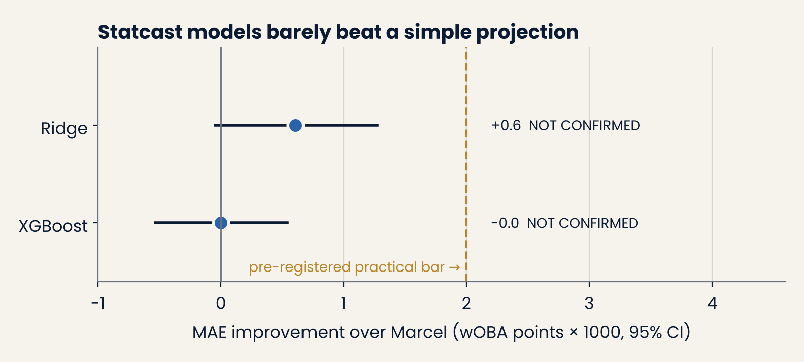
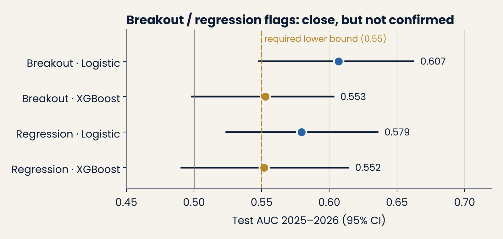
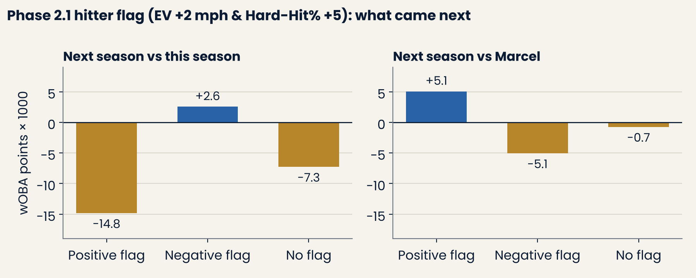

# Phase 3 — Results (hitters MVP)

Design fixed in advance: `docs/PHASE3_PREREGISTRATION.md`. Test set (target seasons 2025–2026) used once.

## EN — Headline
**Public season-level Statcast did not beat a simple projection by the pre-registered margin.**
The best model (Ridge) cut next-season wOBA error by 0.6 points (×1000) versus a bias-corrected Marcel
(95% CI −0.05 to +1.3); the bar was 2.0. XGBoost added nothing (−0.0). Breakout and regression classifiers
ranked hitters better than chance (AUC 0.61 and 0.58) but their lower bounds missed the required 0.55.

| Model (test 2025–2026, n = 528) | MAE | Improvement vs Marcel (95% CI) | Label |
|---|---|---|---|
| Marcel, bias-corrected (K = 3,000) | 0.0240 | — | BASELINE |
| Ridge | 0.0233 | +0.0006 (−0.00005 to +0.0013) | NOT CONFIRMED |
| XGBoost | 0.0240 | −0.0000 (−0.0005 to +0.0005) | NOT CONFIRMED |

| Classifier (test) | AUC (95% CI) | Brier skill | Label |
|---|---|---|---|
| Breakout · Logistic | 0.607 (0.548–0.662) | +3.0% | NOT CONFIRMED |
| Breakout · XGBoost | 0.553 (0.498–0.603) | −0.2% | NOT CONFIRMED |
| Regression · Logistic | 0.579 (0.524–0.636) | +2.5% | NOT CONFIRMED |
| Regression · XGBoost | 0.552 (0.491–0.614) | +1.3% | NOT CONFIRMED |

### What it means for the product
1. **Marcel is the honest baseline for the dashboard.** No breakout/regression probabilities are shown in 2027 lists, as pre-registered. `results/forecast_2027_all.csv` holds Marcel 2027 projections only.
2. **Complex ≠ better.** XGBoost lost to a linear model on every test. With ~2,800 training rows of season averages, simple models win.
3. **Where the signal is:** exit velocity, xwOBA − wOBA and Sweet-Spot% carried most of what the models found (SHAP, Ridge coefficients), but it was small.
4. **The edge must come from data a projection does not use:** bat tracking (once 4+ seasons exist), pitch-level features, physical testing (V3), scouting observations (V4).

### Survivorship check (not dropped)
26% of eligible hitters fell below 200 PA the next season. The regression probability separated them from the rest (AUC 0.69), but plate appearances alone did better (0.78) and Marcel alone 0.76 — so the model adds nothing on who loses a job.

### Phase 2.1 signal rule, checked out of time — `EXPLORATORY`
Rule: EV +2 mph **and** Hard-Hit% +5 pts vs prior season (MLB, 2017–2026 target seasons).

| Flag | n | Next season vs this season | Next season vs Marcel | p vs no flag |
|---|---|---|---|---|
| Positive | 182 | −14.8 wOBA pts | **+5.1** | 0.040 (d = 0.17) |
| Negative | 144 | +2.6 | −5.1 | 0.10 |
| No flag | 1,564 | −7.3 | −0.7 | — |

A positive flag does **not** mean the hitter improves next year — flagged hitters fell back by about 15 wOBA points. It means they kept about 5 points more than the projection expected. Use it as "projection may be too low", not "breakout".

### Next steps
- **Forward test:** the models are frozen as of November 2026. Score them on the 2027 season without changes — the cleanest possible test.
- Add bat speed / swing length when ≥ 4 seasons exist; pitch-level features from Phase 1–2.1 tables; park and team context.
- Pitchers track with the same pre-registered design.

---

## ES — Resumen
**Statcast público por temporada no le ganó a una proyección simple (Marcel) por el margen fijado de antemano.**
El mejor modelo (Ridge) redujo el error del wOBA del año siguiente en 0.6 puntos (×1000); la meta era 2.0.
XGBoost no aportó nada. Los clasificadores de breakout y regresión ordenan mejor que el azar (AUC 0.61 y 0.58),
pero no alcanzaron el mínimo exigido (límite inferior 0.55). Por eso el dashboard 2027 muestra solo la proyección
Marcel, sin probabilidades.

La regla de señales de la Fase 2.1 (EV +2 mph y Hard-Hit% +5) **no** predice que el bateador mejore: el año
siguiente bajaron unos 15 puntos de wOBA. Lo que sí indica es que bajan **menos** de lo que la proyección espera
(+5 puntos sobre Marcel, p = 0.04, exploratorio).

El valor del producto tiene que venir de datos que una proyección no usa: bat tracking con más temporadas,
datos de pitcheo a pitcheo, pruebas físicas y observaciones de scouts.

## Corrections log
- `src/build_db.py`: loading moved from pandas to DuckDB `read_csv_auto` (the full 2017–2026 pitch history would not fit in laptop memory); `fact_statcast_pitch` now keeps regular season only (`game_type = 'R'`); raw table keeps everything.
- Pre-registration amendment 1 (before any model fit): bias-corrected Marcel as the comparison baseline.
