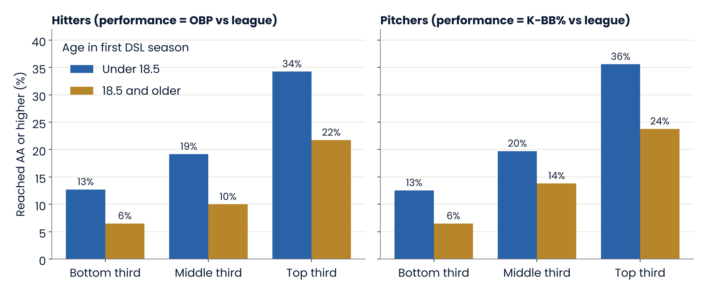
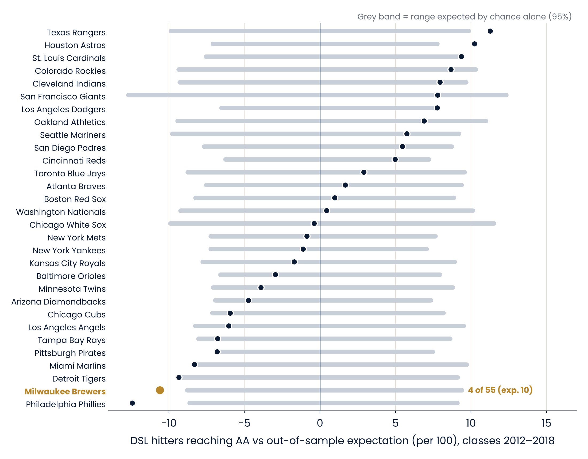
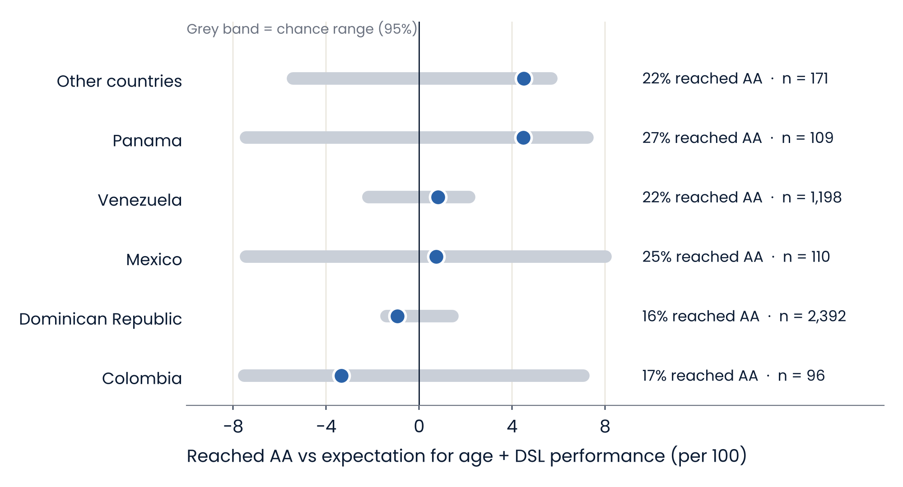

# International Pipeline: What a First DSL Season Tells Us

**Headline (CONFIRMED):** among 4,076 players in their first Dominican Summer League season (classes 2012–2018, followed through 2026), DSL performance adds real signal over age. On the 2016–2018 classes, held out from training, AUC for reaching Double-A rises from **0.57 → 0.74** for hitters and **0.57 → 0.73** for pitchers. Every 95% bootstrap interval for the gain is above zero, and the gain holds with playing time removed from the model.

| Test (classes 2016–2018) | Age only | Age + DSL performance | Gain [95% CI] | Label |
|---|---|---|---|---|
| Hitters → AA | 0.57 | 0.74 | +0.17 [0.12, 0.23] | CONFIRMED |
| Hitters → MLB | 0.57 | 0.79 | +0.22 [0.12, 0.31] | CONFIRMED |
| Pitchers → AA | 0.57 | 0.73 | +0.17 [0.12, 0.22] | CONFIRMED |
| Pitchers → MLB | 0.58 | 0.70 | +0.11 [0.05, 0.18] | CONFIRMED |

## Follow-ups (v1.1)

- **Organizations, out of sample.** Each class is scored by a model trained on the other classes (leave-one-class-out). Milwaukee hitters: 4 of 55 reached AA vs 10 expected, 2nd lowest of 30. Because 30 clubs are compared, a null simulation (5,000 draws from the model's own expectations) checks how often *some* club falls this low by chance alone: **about 18%**. Read it as a direction, not a verdict. Brewers pitchers: 9 of 38 vs 7 expected.
- **Markets by country.** Raw AA rates differ (Dominican Republic 16%, Panama 27%), but after accounting for age and DSL performance, no market falls outside its chance range. The player's age and production explain the gap, not the passport.

## Method

- Source: MLB Stats API (public). Pull script: [`../scripts/ep_dsl_pull.py`](../scripts/ep_dsl_pull.py). Raw JSON is not committed.
- Cohort: first DSL season, hitters ≥100 PA, pitchers ≥100 BF. Stats z-scored within season. Age on July 1.
- Outcome: reached AA, AAA or MLB with an MLB affiliate. The Mexican League (filed under AAA in the API) does not count.
- Model: logistic regression (standardized, C = 0.3). Train 2012–2015, test 2016–2018. Rule fixed before testing: CONFIRMED if AUC gain ≥ 0.02 and the bootstrap 95% CI is above zero.
- Organization = parent club of the player's first DSL team.

Run in order: `src/parse.py RAW WORK` → `src/analysis.py WORK OUT` → `src/sens.py OUT` → `src/recent.py OUT` → `src/analysis2.py OUT` → `src/charts.py OUT FIG` and `src/charts2.py OUT FIG`.

## Limits

Top signees who skip the DSL are missing; signing bonuses and scouting grades are not public. The study measures reaching a level, not value once there. Club samples are small.

## Corrections log

- v1.1: the Mexican League was being counted as AAA, which inflated Mexico-born players' AA rate (52% → 25%). Fixed; all results above use the corrected outcome.

---

## Resumen en español

**Hallazgo (CONFIRMED):** en 4,076 jugadores en su primera temporada de DSL (clases 2012–2018), el rendimiento suma señal real sobre la edad. En las clases 2016–2018, fuera de muestra, el AUC para llegar a AA sube de 0.57 a 0.74 en bateadores y de 0.57 a 0.73 en pitchers.

- **Organizaciones:** bateadores de Milwaukee, 4 de 55 llegaron a AA cuando se esperaban 10 (2º más bajo de 30). Al comparar 30 clubes, que alguno quede así de abajo por puro azar pasa cerca del 18% de las veces: es una dirección, no un veredicto.
- **Mercados:** las tasas crudas por país son distintas, pero al ajustar por edad y rendimiento ningún país sale de su rango de azar.
- **Corrección v1.1:** la Liga Mexicana se contaba como AAA; ya está corregido.

Emerson Jimenez · Emerson Performance · [ejimenezperformance.github.io](https://ejimenezperformance.github.io)
